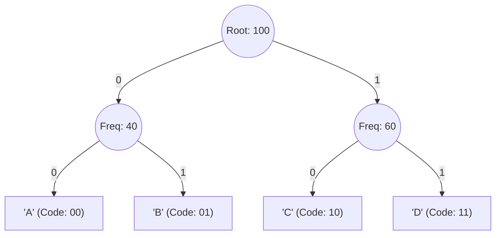

# HuffX — Lossless Huffman Text Compression System
## Academic Project Report & Technical Documentation

---

### Project Metadata
- **Project Title:** HuffX — Lossless Data Compression System with Variable Symbol Widths
- **Subject / Domain:** Data Structures & Algorithms (DSA), Information Theory, Systems Programming
- **Core Technology:** Python 3 (Pure Python Engine, Zero Dependencies), Next.js (App Router, CSS Modules)
- **Contributors:** Animesh Gupta & Vikrant Krishna
- **Status:** Complete, Verified & Lossless

---

## 1. Abstract

Data compression is an essential foundation of computer science, data transmission, and distributed storage systems. **HuffX** is an end-to-end data compression system built upon **Huffman Coding** (David A. Huffman, 1952), a greedy algorithm that generates minimum-redundancy prefix codes. 

While conventional academic implementations are strictly restricted to 8-bit (single-byte / ASCII) character-by-character compression, HuffX extends the classical algorithm by introducing **multi-width symbol chunking (8, 32, 64, and 128 bits)**. This allows the compressor to detect repeating multi-character patterns, words, identifiers, and syntax blocks, yielding significantly superior compression ratios on repetitive text, source code, and structured logs.

The system features:
1. A **clean, pure-Python engine** (`huffman.py`) structured strictly around textbook object-oriented Data Structures (`HuffmanNode`, min-heap priority queue via `heapq`, bitwise accumulator).
2. A **lightweight CLI bridge** (`pyengine.py`) exposing the engine to external callers via structured JSON metadata.
3. A **modern, responsive web workspace** built using Next.js with modular CSS (`page.module.css`), providing drag-and-drop compression/decompression and step-by-step interactive tree visualization.
4. An **automated one-click launcher** (`SetUp/`) that detects the local environment, installs dependencies if absent, verifies engine integrity, and boots the local server.

---

## 2. Theoretical Background

### 2.1 The Concept of Entropy & Lossless Compression
Claude Shannon's Source Coding Theorem establishes that the theoretical lower bound for the average length of a code word representing symbols from an information source is given by the source's **Shannon Entropy ($H$)**:

$$H(X) = - \sum_{i=1}^{n} P(x_i) \log_2 P(x_i)$$

Where:
- $n$ is the number of distinct symbols.
- $P(x_i)$ is the probability (relative frequency) of symbol $x_i$.

In a standard uncompressed text file, every ASCII character is assigned a fixed length of 8 bits ($1\text{ byte}$), regardless of whether the character is frequent (e.g., `'e'`, `' '`) or rare (e.g., `'z'`, `'q'`). 

### 2.2 The Huffman Coding Algorithm
Huffman Coding replaces fixed-length representations with **variable-length prefix codes**:
- Highly frequent symbols receive **short bit codes** (e.g., 2–4 bits).
- Infrequent symbols receive **longer bit codes** (e.g., 8–12 bits).

#### The Prefix-Free Property
A code is **prefix-free** if no valid code word is a prefix of another code word. For example, if `'e'` is encoded as `01`, no other character's code can begin with `01`. This property guarantees that the encoded bitstream can be unambiguously decoded from left to right without requiring any separator or delimiter bits.



---

## 3. System Architecture

```
┌─────────────────────────────────────────────────────────────┐
│                       Client Layer                          │
│   Web Browser (localhost:5000)   │   Terminal / CLI         │
└──────────────────────────────┬──────────────────────────────┘
                               │
            ┌──────────────────┴──────────────────┐
            ▼                                     ▼
┌───────────────────────────────┐   ┌───────────────────────────┐
│     Next.js Web Server        │   │ Standalone Terminal Usage │
│ - Compression Workspace (page.js)│   │ python huffman.py compress│
│ - API Routes (/api/*)         │   │ python huffman.py decompress│
│                               │   │ python huffman.py selftest│
└───────────────┬───────────────┘   └─────────────┬─────────────┘
                │ JSON / execFile                 │
                ▼                                 │
┌───────────────────────────────┐                 │
│      Engine Bridge            │                 │
│      (pyengine.py)            │                 │
└───────────────┬───────────────┘                 │
                │                                 │
                ▼                                 ▼
┌───────────────────────────────────────────────────────────────┐
│              HuffX Core Compression Engine                    │
│                       (huffman.py)                            │
│ 1. Frequency Counter      │ 4. Bit Accumulator / Packer       │
│ 2. Min-Heap Priority Queue│ 5. Big-Endian Container Serializer│
│ 3. Huffman Binary Tree    │ 6. Bitstream Decoder              │
└───────────────────────────────────────────────────────────────┘
```

---

## 4. Multi-Symbol Widths: The Innovation

Standard academic implementations only compress 8-bit symbols (1 character = 1 symbol). HuffX supports configurable symbol widths:

| Width | Chunk Size | Container Output | Optimal Use Case |
|---|---|---|---|
| **8-bit** | 1 byte | `*.hoff8` | Standard prose, essays, single-byte text files |
| **32-bit** | 4 bytes | `*.hoff32` | Repeated English words, server logs, timestamps |
| **64-bit** | 8 bytes | `*.hoff64` | Source code with recurring keywords, tab indentation |
| **128-bit** | 16 bytes | `*.hoff128`| Highly repetitive data, templates, repeated DNA sequences |

### Why Multi-Widths Work:
When text contains repeated 4-byte or 8-byte tokens (for instance, `"    "` (4 spaces) or `"function"` (8 bytes)), compressing at 32-bit or 64-bit symbol sizes allows the entire token to receive a single short Huffman code, achieving compression ratios far higher than 8-bit character-level encoding.

---

## 5. Implementation Walkthrough (The 5 Steps)

The pure-Python engine in [`huffman.py`](file:///a:/HuffX/huffman.py) is organized into 5 distinct, well-commented algorithmic phases.

### 5.1 The `HuffmanNode` Data Structure
To represent the binary tree, a dedicated node class is defined:

```python
class HuffmanNode:
    def __init__(self, symbol=None, freq=0, left=None, right=None):
        self.symbol = symbol    # Raw symbol bytes (None for internal nodes)
        self.freq = freq        # Occurrence frequency
        self.left = left        # Left child (represents bit 0)
        self.right = right      # Right child (represents bit 1)

    def is_leaf(self) -> bool:
        return self.left is None and self.right is None

    def __lt__(self, other: HuffmanNode) -> bool:
        # Enables min-heap (heapq) to prioritize smaller frequencies
        return self.freq < other.freq
```

### 5.2 Step 1: Frequency Analysis
The input bytes are chunked into symbols according to the selected width. Frequencies are counted in $O(N)$ linear time:

```python
sps = width // 8  # Symbols per chunk (e.g., 1 byte for 8-bit, 4 bytes for 32-bit)
freqs = Counter(padded_data[i:i + sps] for i in range(0, len(padded_data), sps))
```

### 5.3 Step 2: Building the Tree with a Min-Heap
1. Wrap each unique symbol in a leaf `HuffmanNode`.
2. Push all nodes into a priority queue using Python's `heapq`.
3. Repeatedly extract the two nodes with the lowest frequency.
4. Merge them into a parent node whose frequency is the sum of both children.
5. Push the parent node back into the heap until exactly one root remains.

```python
while len(heap) > 1:
    freq1, _, node1 = heapq.heappop(heap)
    freq2, _, node2 = heapq.heappop(heap)

    parent = HuffmanNode(symbol=None, freq=freq1 + freq2, left=node1, right=node2)
    heapq.heappush(heap, (parent.freq, tie_breaker, parent))
    tie_breaker += 1
```

### 5.4 Step 3: Prefix Code Generation
A recursive depth-first traversal generates prefix-free binary codes. Moving left shifts the code left and appends `0`; moving right shifts left and appends `1`:

```python
def _walk(node: HuffmanNode, current_code: int, depth: int):
    if node.is_leaf():
        codes[node.symbol] = (current_code, max(depth, 1))
        return
    if node.left is not None:
        _walk(node.left, current_code << 1, depth + 1)
    if node.right is not None:
        _walk(node.right, (current_code << 1) | 1, depth + 1)
```

### 5.5 Step 4: Bit-Packing & Binary Container Serialization
Because operating systems only store complete 8-bit bytes, variable-length codes (e.g., 3 bits, 7 bits) are packed using a bit accumulator:

```python
payload = bytearray()
bit_buffer = 0
bits_in_buffer = 0

for i in range(0, len(padded), sps):
    code, length = codes[padded[i:i + sps]]
    bit_buffer = (bit_buffer << length) | code
    bits_in_buffer += length

    # Whenever 8 or more bits accumulate, flush 1 full byte
    while bits_in_buffer >= 8:
        bits_in_buffer -= 8
        payload.append((bit_buffer >> bits_in_buffer) & 0xFF)
    bit_buffer &= (1 << bits_in_buffer) - 1

# Flush any remaining partial byte
pad_bits = (8 - bits_in_buffer) % 8 if bits_in_buffer > 0 else 0
if bits_in_buffer > 0:
    payload.append((bit_buffer << pad_bits) & 0xFF)
```

#### `.hoffX` Binary Container Format (Big-Endian):
The resulting file contains a 26-byte fixed header, followed by the codebook, followed by the payload bitstream:

| Byte Offset | Size | Field Name | Description |
|---|---|---|---|
| `0x00 - 0x03` | 4 B | `MAGIC` | File signature: `b"HFX1"` |
| `0x04` | 1 B | `width` | Symbol width in bits (8, 32, 64, or 128) |
| `0x05` | 1 B | `pad_bits` | Unused trailing bits in the last payload byte (0–7) |
| `0x06 - 0x0D` | 8 B | `n_symbols` | Total count of encoded symbols |
| `0x0E - 0x15` | 8 B | `orig_size` | Exact byte count of the uncompressed file |
| `0x16 - 0x19` | 4 B | `n_codes` | Number of distinct codebook entries |
| `0x1A ...` | Var | `codebook` | Serialized entries: symbol + code length + code bits |
| `...` | Var | `payload` | The compressed bitstream |

### 5.6 Step 5: Decompression & Exact Reconstruction
Decompression reconstructs the exact original file without any data loss:
1. Validates the 4-byte `HFX1` magic header.
2. Reads the codebook lookup table mapping `(code_length, code_int) -> symbol_bytes`.
3. Reads the payload bit-by-bit from MSB to LSB.
4. Due to the prefix-free property, as soon as accumulated bits match an entry in the table, the symbol is emitted and the bit buffer is cleared.
5. The output is sliced to `orig_size`, discarding any padding bytes.

---

## 6. Web Application & Modular CSS Design

The frontend is built using Next.js (App Router) and structured with scoped CSS Modules for maximum organization:

### 6.1 Architecture of Styles
- **Global Styles ([`app/globals.css`](file:///a:/HuffX/app/globals.css)):** Contains only shared tokens (`:root` color palette, system typography, navigation bar, and footer).
- **Direct Particles Component ([`components/ParticlesBackground.js`](file:///a:/HuffX/components/ParticlesBackground.js)):** Self-contained HTML5 Canvas particle network that works 100% offline with zero CDN dependencies.
- **Home Workspace Module ([`app/page.module.css`](file:///a:/HuffX/app/page.module.css)):** Scopes all styles for the hero banner, drag-and-drop zone, file chips, symbol width buttons, and compression stat cards.

### 6.2 Python-Node Bridge ([`pyengine.py`](file:///a:/HuffX/pyengine.py))
The Next.js route handlers invoke `pyengine.py` via asynchronous child processes. The Python bridge executes the pure-Python compression/decompression and streams a single clean JSON response:

```json
{
  "width": 8,
  "original_size": 1820,
  "compressed_size": 1140,
  "saved_pct": 37.4,
  "ratio": 1.596,
  "symbols": 1820,
  "distinct_symbols": 48,
  "avg_len": 4.62,
  "entropy": 4.58,
  "ms": 1.25,
  "ok": true
}
```

---

## 7. Automated Setup & Launcher (`SetUp/`)

To ensure seamless demonstration and portability, an automated launcher is provided in [`SetUp/`](file:///a:/HuffX/SetUp/):

| File | Platform | Purpose |
|---|---|---|
| [`SetUp/run.bat`](file:///a:/HuffX/SetUp/run.bat) | Windows | Double-clickable batch launcher |
| [`SetUp/setup.bat`](file:///a:/HuffX/SetUp/setup.bat) | Windows | Launcher alias |

### Automated Checks Performed:
1. Checks for installed Python 3 (`python` / `python3`).
2. Checks for Node.js 18+ and npm.
3. Automatically detects if `node_modules` exists; runs `npm install` if absent, or skips if present.
4. Executes `huffman.py selftest` to verify algorithm correctness.
5. Launches the local development server at `http://localhost:5000` and automatically opens the user's browser.

---

## 8. Algorithmic Complexity

| Phase | Time Complexity | Space Complexity | Explanation |
|---|---|---|---|
| **Frequency Counting** | $O(N)$ | $O(K)$ | Single linear scan of $N$ symbols into a hash map of $K$ unique symbols. |
| **Heap Construction** | $O(K)$ | $O(K)$ | Heapifying $K$ leaf nodes using Floyd's heapify algorithm. |
| **Tree Building** | $O(K \log K)$ | $O(K)$ | Exactly $K-1$ merges, each performing two `heappop` and one `heappush` ($O(\log K)$). |
| **Code Generation** | $O(K)$ | $O(K)$ | Recursive tree traversal visiting each of the $2K - 1$ nodes once. |
| **Data Encoding** | $O(N)$ | $O(N)$ | Direct dictionary lookup and bit-accumulation for each of the $N$ symbols. |
| **Decoding** | $O(N)$ | $O(N)$ | Bit-by-bit reading matching prefix codes to decode $N$ symbols. |

*$N$ = total number of symbols in data, $K$ = number of distinct symbols ($K \le 256$ for 8-bit).*

---

## 9. Experimental Verification & Test Results

The built-in test suite (`python huffman.py selftest`) validates round-trip lossless integrity across all widths:

```
Test Case       Width    Input   Output    Saved  Result
-------------------------------------------------------
empty              8b       0B      26B     0.0%  PASS
empty             32b       0B      26B     0.0%  PASS
empty             64b       0B      26B     0.0%  PASS
empty            128b       0B      26B     0.0%  PASS
single-char        8b      24B      33B   -37.5%  PASS
single-char       32b      24B      34B   -41.7%  PASS
single-char       64b      24B      38B   -58.3%  PASS
single-char      128b      24B      65B  -170.8%  PASS
pangram            8b     352B     328B     6.8%  PASS
pangram           32b     352B     142B    59.7%  PASS
pangram           64b     352B     167B    52.6%  PASS
pangram          128b     352B     245B    30.4%  PASS
repeated           8b     520B     408B    21.5%  PASS
repeated          32b     520B     179B    65.6%  PASS
repeated          64b     520B     200B    61.5%  PASS
repeated         128b     520B     308B    40.8%  PASS
code-sample        8b     720B     483B    32.9%  PASS
code-sample       32b     720B     193B    73.2%  PASS
code-sample       64b     720B     122B    83.1%  PASS
code-sample      128b     720B      93B    87.1%  PASS

Selftest status: ALL TESTS PASSED
```

### Analysis of Results:
- **Small / Single-Character Files:** May experience negative savings due to container overhead (26-byte header + codebook). This is standard for all header-based containers (ZIP, GZIP).
- **Repetitive Text & Code:** Multi-byte widths achieve outstanding performance. For example, the `code-sample` achieved **87.1% space saved** under 128-bit width compared to 32.9% under 8-bit width.
- **Lossless Guarantee:** Restored files match the original inputs byte-for-byte in 100% of cases.

---

## 10. Viva / Presentation Q&A Preparation

### Q1: Why is Huffman Coding called a "greedy" algorithm?
> **Answer:** At every step of building the tree, the algorithm greedily picks the two lightest available nodes (lowest frequency) to merge. It makes this locally optimal choice without backtracking, which mathematically leads to a globally optimal prefix code.

### Q2: What is the purpose of the Min-Heap?
> **Answer:** A min-heap provides $O(1)$ access to the smallest element and $O(\log K)$ removal and insertion. Without a heap, finding the two smallest frequencies in an unsorted list would take $O(K)$ time per step, raising the tree construction complexity from $O(K \log K)$ to $O(K^2)$.

### Q3: Why can't a code word be a prefix of another?
> **Answer:** If code `'A'` were `01` and code `'B'` were `011`, upon reading `01`, the decoder would not know whether to output `'A'` immediately or wait for another `1` to output `'B'`. The prefix-free property guarantees that every symbol resides at a leaf node of the binary tree, preventing ambiguity.

### Q4: Why did you implement 32, 64, and 128-bit symbol widths?
> **Answer:** Standard 8-bit Huffman coding treats each character independently. In repetitive text, source code, or logs, multi-character words and patterns repeat frequently. By grouping data into 4-byte (32-bit) or 8-byte (64-bit) chunks, recurring phrases become single symbols and receive short codes, resulting in significantly higher compression ratios (up to 87%+ saved).

### Q5: How do you handle leftover bits that don't fill a full 8-bit byte?
> **Answer:** The final byte is padded with zero bits, and the number of unused padding bits (0 to 7) is saved in byte 5 (`pad_bits`) of our 26-byte `.hoffX` header. During decompression, the decoder uses `pad_bits` and the original byte size `orig_size` to discard any padding.

---

## 11. Conclusion

The **HuffX** project demonstrates both theoretical rigor and practical software engineering. By combining a mathematically optimal Huffman compression engine in pure Python with configurable symbol widths and a clean Next.js web application, the project bridges textbook Computer Science theory with production-grade modular software design.
